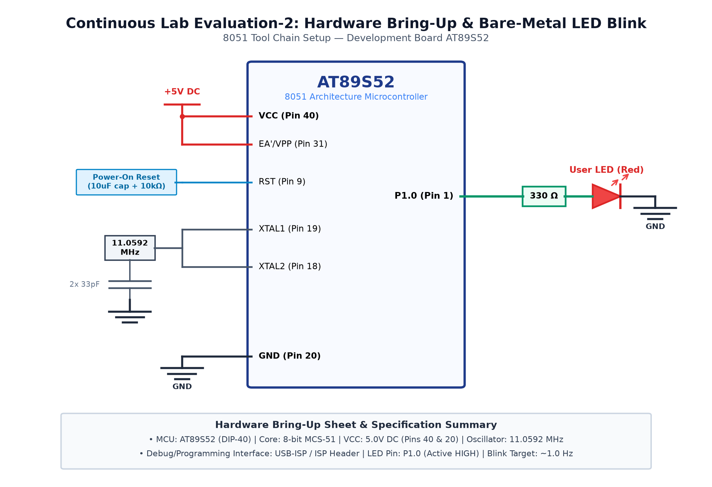

# EXPERIMENT DETAILS

**EXP:** CONTINUOUS ASSESMENT 2

**DATE:** 20/07/2026

**NAME OF EXP:** 8051 Development Board Tool Chain Setup & Hardware Bring-Up

**HARDWARE SETUP / PLATFORM:** 8051 Microcontroller (AT89S52) + Keil µVision + USB-ISP

---

## Overview

This experiment covers the foundational hardware bring-up of the Atmel AT89S52 microcontroller, configuring the Keil C51 compiler toolchain, and implementing bare-metal GPIO output and reusable software delays.

## Dedicated Tasks

- **[TASK 2A: Hardware Board Bring-Up](TASK2A/)**: Verification of power rails, clock oscillator (11.0592 MHz), and reset circuitry.
- **[TASK 2B: 1 Hz LED Blink on Port 2](TASK2B/)**: Continuous 1 Hz square-wave blinking of all 8 LEDs on Port 2.
- **[TASK 2C: Reusable Software Delay Library](TASK2C/)**: Calibrated millisecond delay library based on machine cycle calculation.

### Circuit Diagram

The overall hardware schematic for Continuous Assessment 2 is shown below:

### Inference

The 8051 development board was brought up successfully. GPIO digital output switching was confirmed on Port 2 with calibrated software timing.
