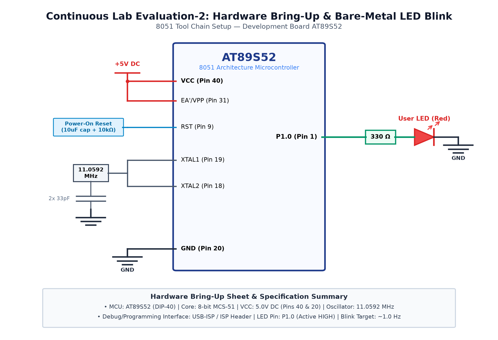

# EXPERIMENT DETAILS

**EXP:** CONTINUOUS ASSESMENT 2

**DATE:** 20/07/2026

**NAME OF EXP:** 8051 Development Board Tool Chain Setup & Hardware Bring-Up

**HARDWARE SETUP / PLATFORM:** 8051 Microcontroller (AT89S52) + Keil µVision + USB-ISP

---

## TASK 2A : Hardware Board Bring-Up

### 1. Circuit Diagram

The experiment demonstrates initial board bring-up, verifying power distribution, clock oscillation, and active-high reset integrity.

- **Development Board / Core:** 8051 Development Board
- **Microcontroller IC:** Atmel AT89S52 (40-Pin DIP)
- **GPIO Pin(s) / Peripherals:** VCC (Pin 40), GND (Pin 20), EA/VPP (Pin 31), RST (Pin 9)
- **Power Supply / Interface:** 5V Regulated DC Supply

### 2. Core Logic / Pseudocode / Code Base

**Working Principle:**

The AT89S52 requires a stable 5V rail, an external 11.0592 MHz quartz crystal with two 33pF ceramic capacitors, and an active-high RC reset network. Once EA is tied to VCC, execution starts from address 0x0000.

**Pseudocode:**

1. Connect regulated 5V DC power supply to VCC and GND.
2. Confirm 5V DC across Pin 40 and Pin 20.
3. Ensure Pin 31 (EA) is connected to +5V.
4. Observe 11.0592 MHz sine wave on XTAL1/XTAL2.
5. Press Reset button to trigger active-high pulse on Pin 9.

**Code Base:**

- `reg51.h`: Provides standard 8051 register definitions.
- `STARTUP.A51`: Initializes data memory and sets the program counter to `0x0000`.
- `P2 = 0xFF`: Sets Port 2 to inactive high state.

### 3. Inference

Hardware supply rails, crystal clock, and reset behavior were verified to be fully operational.
