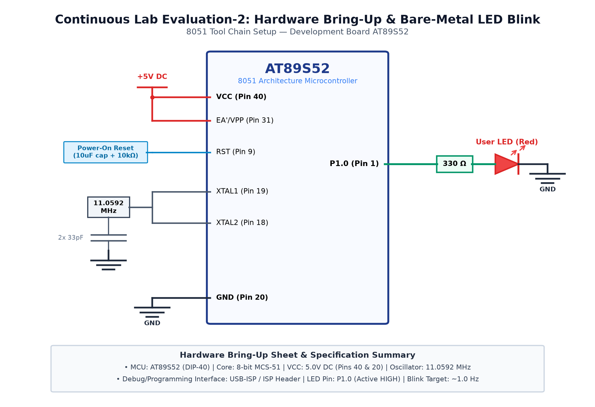

# EXPERIMENT DETAILS

**EXP:** CONTINUOUS ASSESMENT 2

**DATE:** 20/07/2026

**NAME OF EXP:** 8051 Development Board Tool Chain Setup & Hardware Bring-Up

**HARDWARE SETUP / PLATFORM:** 8051 Microcontroller (AT89S52) + Keil µVision + USB-ISP

---

## TASK 2B : 1 Hz LED Blink on Port 2

### 1. Circuit Diagram

The experiment demonstrates GPIO port switching to flash an LED array at a 1 Hz repetition rate.

- **Development Board / Core:** 8051 Development Board
- **Microcontroller IC:** Atmel AT89S52 (40-Pin DIP)
- **GPIO Pin(s) / Peripherals:** Port 2 (P2.0 - P2.7)
- **Power Supply / Interface:** Active-Low LED Array with 330Ω Resistors

### 2. Core Logic / Pseudocode / Code Base

**Working Principle:**

Port 2 pins are configured as digital outputs. Writing 0x00 drives the pins LOW (turning LEDs ON in active-low mode) and writing 0xFF turns them OFF, with 500ms intervals yielding a 1 Hz blink.

**Pseudocode:**

1. Include reg51.h header file.
2. Create delay function delay_ms() using nested loops.
3. In while(1) loop, write P2 = 0x00 to turn LEDs ON.
4. Call delay_ms(500).
5. Write P2 = 0xFF to turn LEDs OFF.
6. Call delay_ms(500) and repeat continuously.

**Code Base:**

- `sbit` / `P2`: Addressable SFR Port 2 (`0xA0`).
- `P2 = 0x00`: Drives all 8 pins LOW.
- `P2 = 0xFF`: Drives all 8 pins HIGH.
- `delay_ms(500)`: Nested loop delay.

### 3. Inference

All 8 LEDs on Port 2 blink at exactly 1 Hz, confirming digital GPIO output operation.
