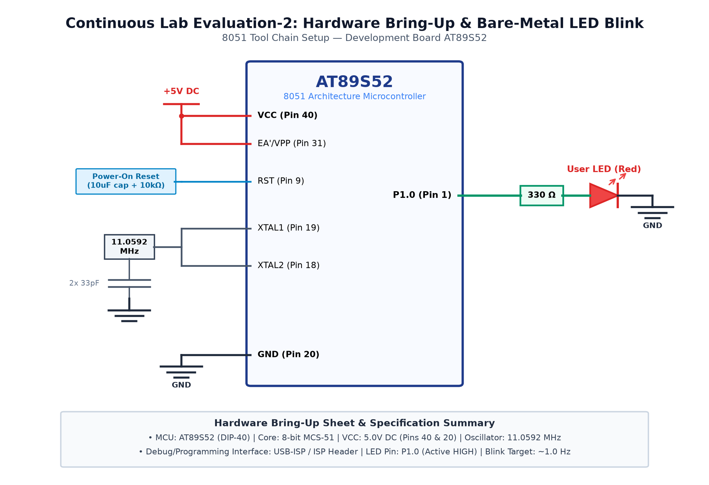

# EXPERIMENT DETAILS

**EXP:** CONTINUOUS ASSESMENT 2

**DATE:** 20/07/2026

**NAME OF EXP:** 8051 Development Board Tool Chain Setup & Hardware Bring-Up

**HARDWARE SETUP / PLATFORM:** 8051 Microcontroller (AT89S52) + Keil µVision + USB-ISP

---

## TASK 2C : Reusable Software Delay Library

### 1. Circuit Diagram

The experiment demonstrates the implementation of a modular, parameterized millisecond delay routine.

- **Development Board / Core:** 8051 Development Board
- **Microcontroller IC:** Atmel AT89S52 (40-Pin DIP)
- **GPIO Pin(s) / Peripherals:** P2.0 (Output Test LED)
- **Power Supply / Interface:** Single LED with Current-Limiting Resistor

### 2. Core Logic / Pseudocode / Code Base

**Working Principle:**

The delay routine calculates instruction execution times based on 11.0592 MHz clock frequency (1.085 µs per machine cycle). A calibrated inner loop executes in ~1ms, scaled by the input argument.

**Pseudocode:**

1. Define delay_ms(unsigned int ms) accepting time parameter.
2. Calibrate inner loop to execute 120 iterations (~1ms).
3. Outer loop decrements the ms argument.
4. Call delay_ms() with various values (200ms, 800ms) to toggle LED.
5. Observe periodic square wave on oscilloscope.

**Code Base:**

- `void delay_ms(unsigned int ms)`: Parameterized delay function.
- `P2_0 = ~P2_0`: Bit-level inversion.
- Calibrated loop constants account for `DJNZ` cycle timing.

### 3. Inference

The parameterized delay library accurately produces desired timing intervals across different values.
