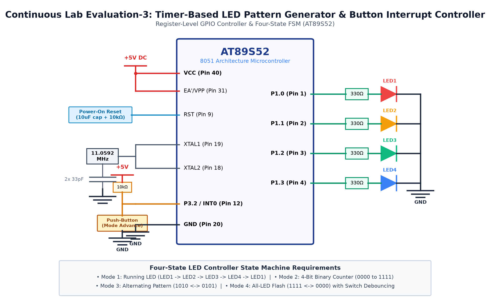

# EXPERIMENT DETAILS

**EXP:** CONTINUOUS ASSESMENT 3

**DATE:** 27/07/2026

**NAME OF EXP:** Timer-Based LED Pattern Generator & Push-Button Controller

**HARDWARE SETUP / PLATFORM:** 8051 Microcontroller (AT89S52) + 4 LEDs + Push Button

---

## TASK 3A : Multi-Mode Switch Controller

### 1. Circuit Diagram

The experiment demonstrates button-driven mode switching that toggles through multiple LED sequencing patterns.

- **Development Board / Core:** 8051 Development Board
- **Microcontroller IC:** Atmel AT89S52 (40-Pin DIP)
- **GPIO Pin(s) / Peripherals:** P3.2 (Active-Low Button), P2.0 - P2.3 (4 LEDs)
- **Power Supply / Interface:** Tactile Switch + 4 LEDs

### 2. Core Logic / Pseudocode / Code Base

**Working Principle:**

An active-low push button connected to P3.2 is polled in software. When pressed, a 20ms software debounce prevents false triggers, and an internal mode counter increments to switch active LED patterns.

**Pseudocode:**

1. Set P3.2 = 1 to configure as input pin.
2. In superloop, monitor P3.2 for logic LOW.
3. When pressed, call delay_ms(20) to debounce.
4. Wait until button is released.
5. Increment mode counter (0 to 2) and execute corresponding LED routine.

**Code Base:**

- `sbit BTN = P3^2`: Input button declaration.
- `sbit LED0 - LED3`: Port 2 output pins.
- `mode = (mode + 1) % 3`: Mode selector logic.

### 3. Inference

Pressing the switch reliably switches operating modes without debounce glitches.
