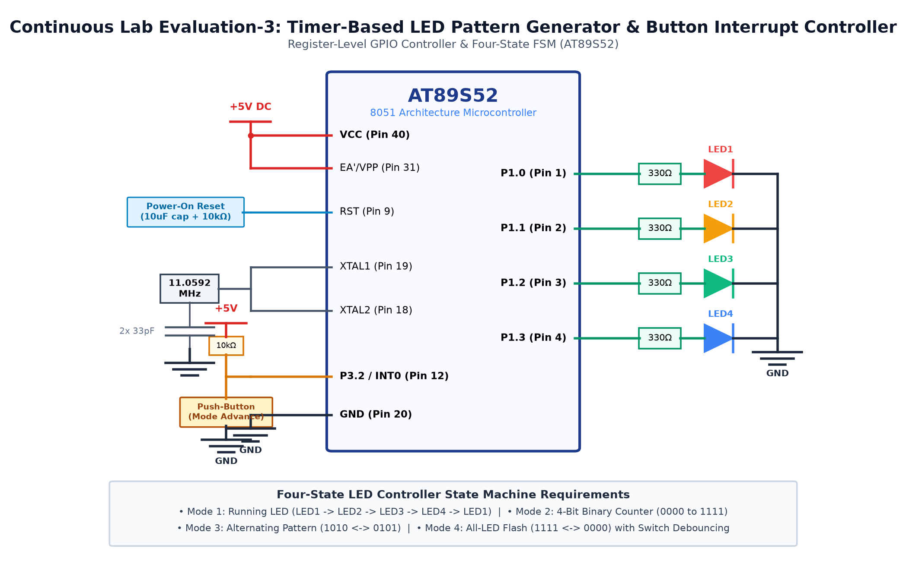

# EXPERIMENT DETAILS

**EXP:** CONTINUOUS ASSESMENT 3

**DATE:** 27/07/2026

**NAME OF EXP:** Timer-Based LED Pattern Generator & Push-Button Controller

**HARDWARE SETUP / PLATFORM:** 8051 Microcontroller (AT89S52) + 4 LEDs

---

## TASK 3B : 4-Bit Binary Counter

### 1. Circuit Diagram

The experiment demonstrates a 4-bit binary up-counter displaying values 0 to 15 on four LEDs.

- **Development Board / Core:** 8051 Development Board
- **Microcontroller IC:** Atmel AT89S52 (40-Pin DIP)
- **GPIO Pin(s) / Peripherals:** P2.0 - P2.3 (Lower Nibble Port 2)
- **Power Supply / Interface:** 4 LEDs with 330Ω Resistors

### 2. Core Logic / Pseudocode / Code Base

**Working Principle:**

An 8-bit integer counter increments from 0 to 15 on every cycle. Its lower nibble is masked and written directly to Port 2 pins with a 300ms pause between counts.

**Pseudocode:**

1. Initialize count variable to 0.
2. Write (~count & 0x0F) to Port 2 (active-low display).
3. Delay for 300 milliseconds.
4. Increment count by 1.
5. Reset count to 0 when it exceeds 15 and repeat.

**Code Base:**

- `unsigned char count`: 4-bit counter variable.
- `P2 = (P2 & 0xF0) | (~count & 0x0F)`: Masks upper nibble and updates lower nibble.

### 3. Inference

The LEDs accurately display sequential binary counting from 0000 to 1111.
