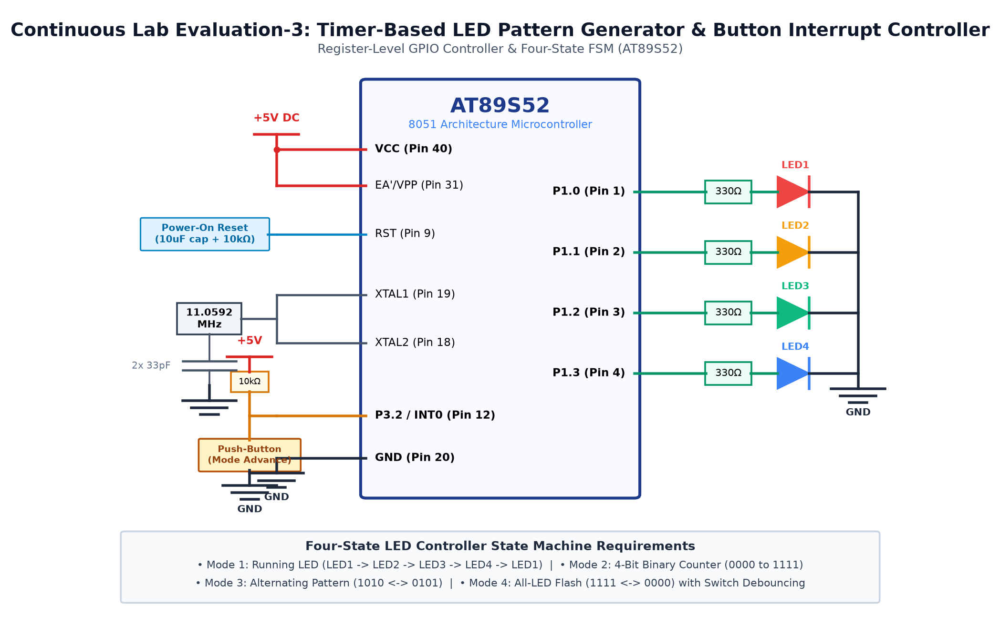

# EXPERIMENT DETAILS

**EXP:** CONTINUOUS ASSESMENT 3

**DATE:** 27/07/2026

**NAME OF EXP:** Timer-Based LED Pattern Generator & Push-Button Controller

**HARDWARE SETUP / PLATFORM:** 8051 Microcontroller (AT89S52) + 4 LEDs

---

## TASK 3C : Alternating LED Pattern

### 1. Circuit Diagram

The experiment demonstrates alternating odd and even LED flashing.

- **Development Board / Core:** 8051 Development Board
- **Microcontroller IC:** Atmel AT89S52 (40-Pin DIP)
- **GPIO Pin(s) / Peripherals:** P2.0 - P2.3 (Port 2)
- **Power Supply / Interface:** 4 LEDs with 330Ω Resistors

### 2. Core Logic / Pseudocode / Code Base

**Working Principle:**

The microcontroller alternately illuminates odd-indexed LEDs (LED1, LED3) and even-indexed LEDs (LED0, LED2) with a 250ms interval, creating an alert pattern.

**Pseudocode:**

1. Output 0x05 to lower nibble of Port 2 (LEDs 0 and 2 ON).
2. Delay 250 milliseconds.
3. Output 0x0A to lower nibble of Port 2 (LEDs 1 and 3 ON).
4. Delay 250 milliseconds.
5. Repeat indefinitely.

**Code Base:**

- `P2 = 0xFA` / `P2 = 0xF5`: Bitmasks toggling odd/even LED groups.

### 3. Inference

The alternating flash pattern executed smoothly with balanced timing between groups.
