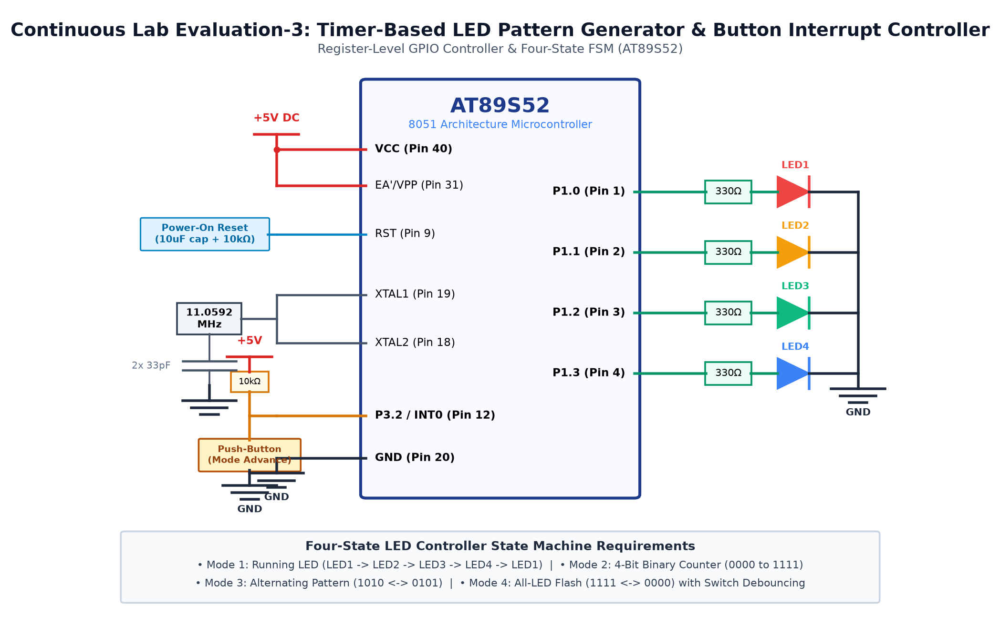

# EXPERIMENT DETAILS

**EXP:** CONTINUOUS ASSESMENT 3

**DATE:** 27/07/2026

**NAME OF EXP:** Timer-Based LED Pattern Generator & Push-Button Controller

**HARDWARE SETUP / PLATFORM:** 8051 Microcontroller (AT89S52) + 4 LEDs

---

## TASK 3D : All-LED Synchronous Flash

### 1. Circuit Diagram

The experiment demonstrates all 4 LEDs blinking simultaneously with equal ON and OFF intervals.

- **Development Board / Core:** 8051 Development Board
- **Microcontroller IC:** Atmel AT89S52 (40-Pin DIP)
- **GPIO Pin(s) / Peripherals:** P2.0 - P2.3 (Port 2)
- **Power Supply / Interface:** 4 LEDs with 330Ω Resistors

### 2. Core Logic / Pseudocode / Code Base

**Working Principle:**

All four LEDs are turned ON concurrently by setting output bits LOW, held for 200ms, then turned OFF for 200ms, creating a strobe flash pattern.

**Pseudocode:**

1. Set all four LED pins LOW (ON).
2. Call delay_ms(200).
3. Set all four LED pins HIGH (OFF).
4. Call delay_ms(200).
5. Repeat in continuous loop.

**Code Base:**

- `P2 = 0xF0`: Turns ON all lower nibble LEDs.
- `P2 = 0xFF`: Turns OFF all lower nibble LEDs.
- `delay_ms(200)`: Fixed timing interval.

### 3. Inference

Synchronous flashing across all 4 channels was verified with sharp transitions.
