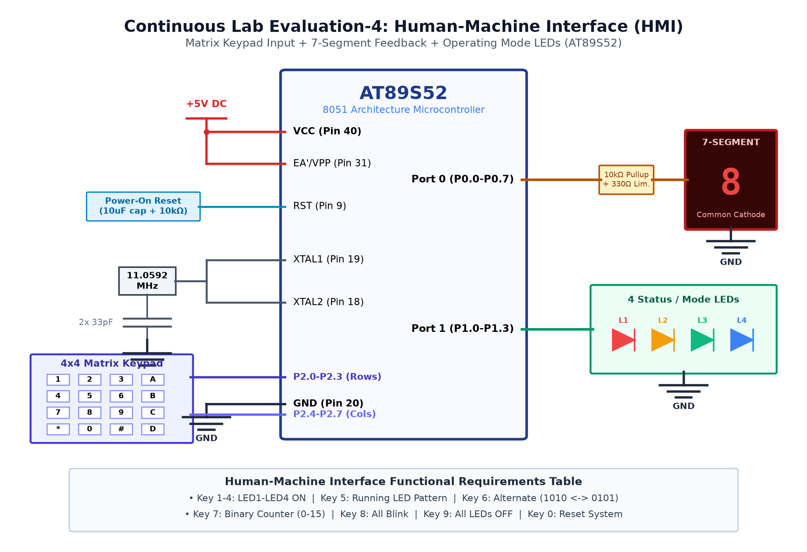

# EXPERIMENT DETAILS

**EXP:** CONTINUOUS ASSESMENT 4

**DATE:** 03/08/2026

**NAME OF EXP:** Human-Machine Interface using Matrix Keypad, LEDs & 7-Segment Display

**HARDWARE SETUP / PLATFORM:** AT89S52 Microcontroller + 4x4 Matrix Keypad + Common-Anode 7-Segment + 4 LEDs

---

## Overview

This experiment covers human-machine interfacing (HMI) using an 8051 microcontroller, including matrix keypad row-column scanning, 7-segment display numeric decoding, and keypad-triggered LED animation control.

## Dedicated Tasks

- **[TASK 4A: 4x4 Keypad Row-Column Scanning HMI](TASK4A/)**: Matrix scanning algorithm detecting key presses and mapping them to ASCII characters.
- **[TASK 4B: 7-Segment Display Output Driver](TASK4B/)**: Driving a common-anode 7-segment display with decoded numeric hex patterns (0-9).
- **[TASK 4C: Keypad-Controlled LED Patterns](TASK4C/)**: Interactive control triggering unique LED animation patterns based on keypad inputs.

### Circuit Diagram

The overall hardware schematic for Continuous Assessment 4 is shown below:

### Inference

The 4x4 matrix keypad and 7-segment display were successfully interfaced with the AT89S52, establishing robust interactive input/output control.
