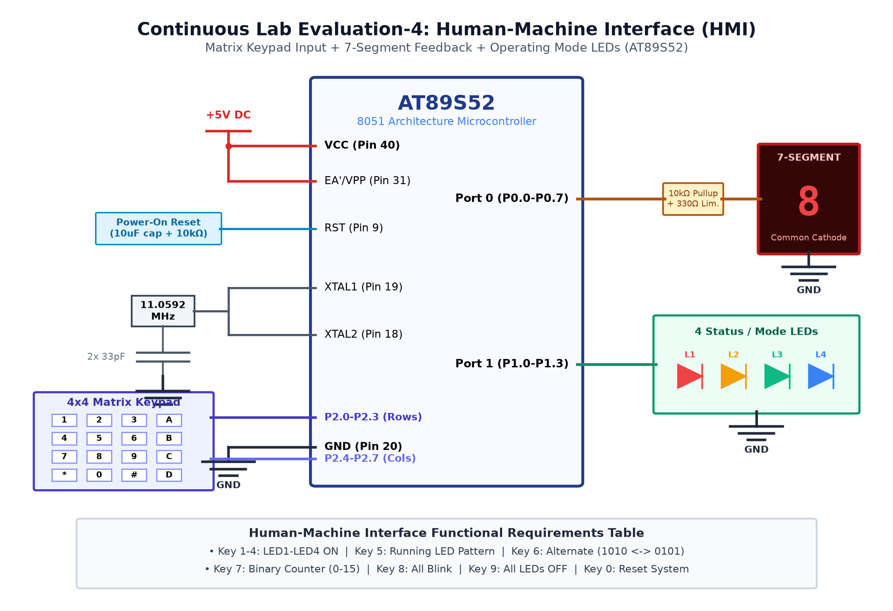

# EXPERIMENT DETAILS

**EXP:** CONTINUOUS ASSESMENT 4

**DATE:** 03/08/2026

**NAME OF EXP:** Human-Machine Interface using Matrix Keypad, LEDs & 7-Segment Display

**HARDWARE SETUP / PLATFORM:** AT89S52 Microcontroller + 4x4 Matrix Keypad

---

## TASK 4A : 4x4 Keypad Row-Column Scanning HMI

### 1. Circuit Diagram

The experiment demonstrates row-column scanning on a 4x4 matrix keypad to identify pressed keys.

- **Development Board / Core:** 8051 Development Board
- **Microcontroller IC:** Atmel AT89S52 (40-Pin DIP)
- **GPIO Pin(s) / Peripherals:** Port 1 (P1.0 - P1.3 as Row Outputs, P1.4 - P1.7 as Column Inputs)
- **Power Supply / Interface:** 4x4 Matrix Keypad + 10kΩ Pull-Up Resistors

### 2. Core Logic / Pseudocode / Code Base

**Working Principle:**

Rows are sequentially pulled LOW one by one while columns are read. When a key is pressed, it pulls the intersecting column line LOW. Software matches the active row and column indices to identify the key.

**Pseudocode:**

1. Set all column pins (P1.4-P1.7) as inputs with pull-ups.
2. Drive Row 0 LOW, Rows 1-3 HIGH.
3. Read column pins; if any is LOW, identify pressed key.
4. Repeat for Row 1, Row 2, and Row 3 sequentially.
5. Debounce the detected key and return corresponding key code.

**Code Base:**

- `P1`: Interfaced to 4x4 keypad matrix.
- `unsigned char keypad_scan()`: Scanning routine returning character.
- `delay_ms(20)`: Software debounce filter.

### 3. Inference

Matrix row-column scanning reliably identified every key pressed on the 4x4 keypad.
