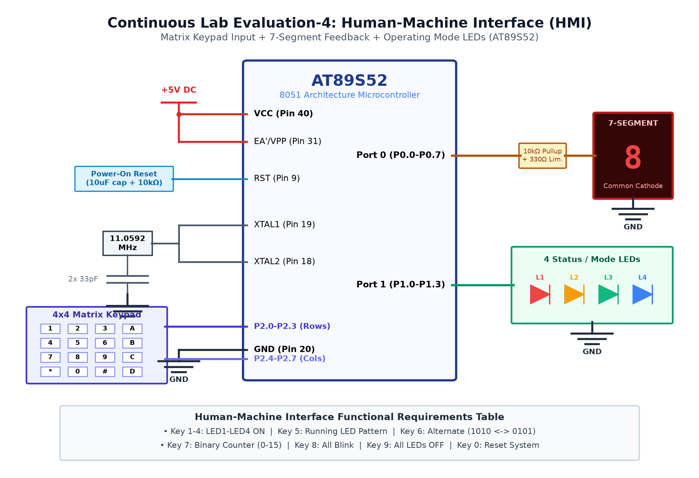

# EXPERIMENT DETAILS

**EXP:** CONTINUOUS ASSESMENT 4

**DATE:** 03/08/2026

**NAME OF EXP:** Human-Machine Interface using Matrix Keypad, LEDs & 7-Segment Display

**HARDWARE SETUP / PLATFORM:** AT89S52 Microcontroller + Common-Anode 7-Segment Display

---

## TASK 4B : 7-Segment Display Output Driver

### 1. Circuit Diagram

The experiment demonstrates displaying decimal digits (0 to 9) on a common-anode 7-segment display.

- **Development Board / Core:** 8051 Development Board
- **Microcontroller IC:** Atmel AT89S52 (40-Pin DIP)
- **GPIO Pin(s) / Peripherals:** Port 0 (P0.0 - P0.7 for Segments A-G and DP)
- **Power Supply / Interface:** Common-Anode 7-Segment LED + 330Ω Current-Limiting Resistors

### 2. Core Logic / Pseudocode / Code Base

**Working Principle:**

In a common-anode 7-segment display, segment cathodes are driven LOW to illuminate individual segments. A lookup table converts numbers 0 to 9 into corresponding 8-bit cathode bit patterns.

**Pseudocode:**

1. Connect common anode pin to +5V DC.
2. Connect segment pins A-G to Port 0 through 330Ω resistors.
3. Define 10-element lookup array with hex segment codes.
4. Loop through indices 0 to 9.
5. Output lookup code to Port 0 with 500ms delay between numbers.

**Code Base:**

- `code unsigned char seg_codes[] = {0xC0, 0xF9, 0xA4, 0xB0, 0x99, 0x92, 0x82, 0xF8, 0x80, 0x90}`.
- `P0 = seg_codes[digit]`: Updates display output.
- Pull-up resistors on Port 0 ensure valid high logic levels.

### 3. Inference

The 7-segment display cleanly rendered digits 0 through 9 in sequence without ghosting.
