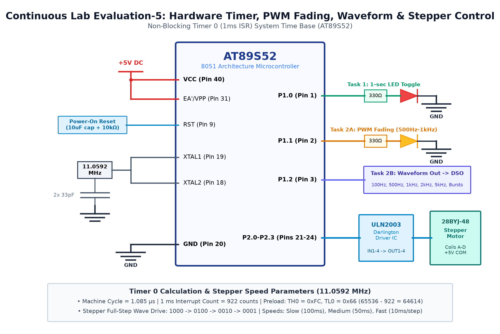

# EXPERIMENT DETAILS

**EXP:** CONTINUOUS ASSESMENT 5

**DATE:** 10/08/2026

**NAME OF EXP:** Hardware Timers for PWM Waveform Generation & Stepper Motor Control

**HARDWARE SETUP / PLATFORM:** AT89S52 Microcontroller + Timer 0 + Oscilloscope

---

## TASK 5A : 1ms Timer 0 Mode 1 Periodic ISR Driver

### 1. Circuit Diagram

The experiment demonstrates configuring 8051 Timer 0 in 16-bit Mode 1 to generate accurate 1ms periodic interrupts.

- **Development Board / Core:** 8051 Development Board
- **Microcontroller IC:** Atmel AT89S52 (40-Pin DIP)
- **GPIO Pin(s) / Peripherals:** P2.0 (Output Test Pin), XTAL1/XTAL2 (11.0592 MHz)
- **Power Supply / Interface:** Digital Storage Oscilloscope (DSO)

### 2. Core Logic / Pseudocode / Code Base

**Working Principle:**

Timer 0 operates in 16-bit mode with clock = 11.0592 MHz / 12 = 921.6 kHz (1.085 µs per count). For a 1ms interrupt interval, the counter requires 921 counts. Preload value = 65536 - 921 = 64615 (0xFC67).

**Pseudocode:**

1. Set TMOD = 0x01 (Timer 0, 16-bit Mode 1).
2. Load TH0 = 0xFC, TL0 = 0x67.
3. Enable Timer 0 interrupt (ET0 = 1) and global interrupts (EA = 1).
4. Start Timer 0 (TR0 = 1).
5. In ISR (interrupt 1), reload TH0 and TL0, and toggle test pin P2.0.

**Code Base:**

- `TMOD = 0x01`: 16-bit Timer 0.
- `TH0 = 0xFC; TL0 = 0x67`: 1ms reload value.
- `void timer0_isr(void) interrupt 1`: Handles overflow and toggles P2.0.

### 3. Inference

Oscilloscope measurement confirmed an exact 500 Hz square wave (1ms period per half-cycle), verifying the timer accuracy.
