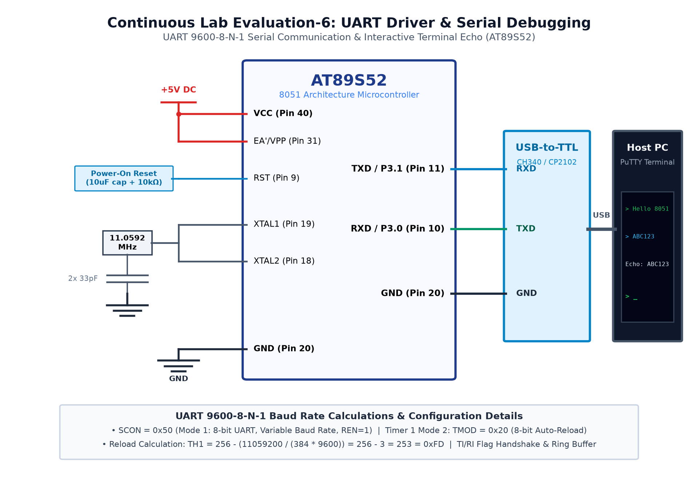

# EXPERIMENT DETAILS

**EXP:** CONTINUOUS ASSESMENT 6

**DATE:** 17/08/2026

**NAME OF EXP:** UART Driver Development & Serial Debugging Interface

**HARDWARE SETUP / PLATFORM:** AT89S52 Microcontroller + Timer 1 Baud Generator + USB-TTL Bridge + PuTTY Terminal

---

## Overview

This experiment covers serial communication on the 8051, configuring Timer 1 in Mode 2 for 9600 baud generation, implementing polled character transmission, and designing an interrupt-driven UART receiver with circular buffering.

## Dedicated Tasks

- **[TASK 6A: Polled UART String Transmission @ 9600 Baud](TASK6A/)**: Asynchronous serial transmission of character strings using polled TI flag.
- **[TASK 6B: Interrupt-Driven UART Echo with Circular Buffer](TASK6B/)**: Full-duplex UART communication using receive interrupts and ring buffering.

### Circuit Diagram

The overall hardware schematic for Continuous Assessment 6 is shown below:

### Inference

Serial communication was established at 9600 baud, enabling reliable string transmission and full-duplex terminal character echoing.
