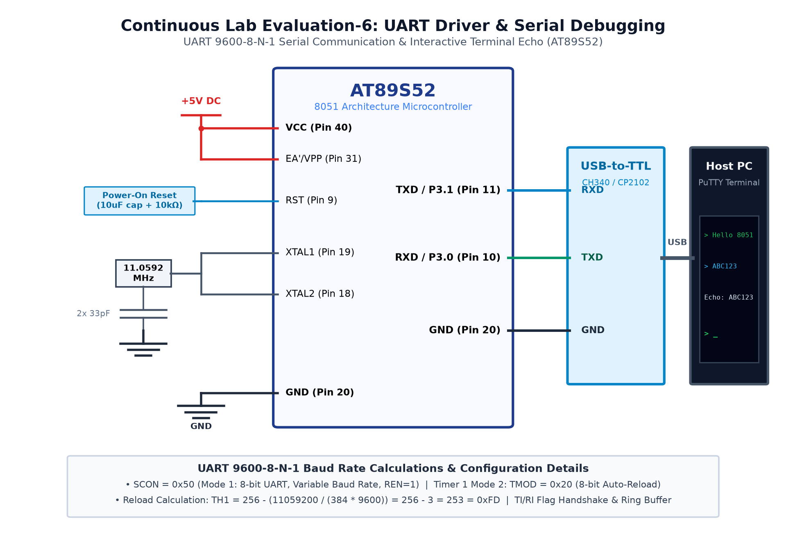

# EXPERIMENT DETAILS

**EXP:** CONTINUOUS ASSESMENT 6

**DATE:** 17/08/2026

**NAME OF EXP:** UART Driver Development & Serial Debugging Interface

**HARDWARE SETUP / PLATFORM:** AT89S52 Microcontroller + USB-to-UART Bridge + PC Terminal

---

## TASK 6A : Polled UART String Transmission @ 9600 Baud

### 1. Circuit Diagram

The experiment demonstrates configuring the 8051 hardware UART to transmit formatted ASCII text strings at 9600 baud.

- **Development Board / Core:** 8051 Development Board
- **Microcontroller IC:** Atmel AT89S52 (40-Pin DIP)
- **GPIO Pin(s) / Peripherals:** P3.1 (TXD), P3.0 (RXD)
- **Power Supply / Interface:** CP2102 USB-to-TTL Serial Adapter + PuTTY Terminal @ 9600 8-N-1

### 2. Core Logic / Pseudocode / Code Base

**Working Principle:**

Timer 1 in Mode 2 (8-bit auto-reload) generates the standard 9600 baud clock. SCON is configured for 8-bit variable baud rate (Mode 1). Strings are transmitted character-by-character, polling the TI flag after each write to SBUF.

**Pseudocode:**

1. Set TMOD = 0x20 (Timer 1, Mode 2 8-bit auto-reload).
2. Load TH1 = 0xFD (9600 baud @ 11.0592 MHz).
3. Set SCON = 0x50 (Mode 1, 8-bit data, receiver enabled).
4. Start Timer 1 (TR1 = 1).
5. For each character: write to SBUF, wait until TI == 1, clear TI.
6. Transmit hello banner to PC terminal.

**Code Base:**

- `TH1 = 0xFD`: Baud rate reload constant.
- `SCON = 0x50`: 8-bit UART mode.
- `void uart_tx(char c)`: Waits on `TI` and sends byte.
- `void uart_send_string(char *s)`: Iterates null-terminated string.

### 3. Inference

The microcontroller transmitted text strings cleanly to the PuTTY terminal without frame errors or dropped characters.
