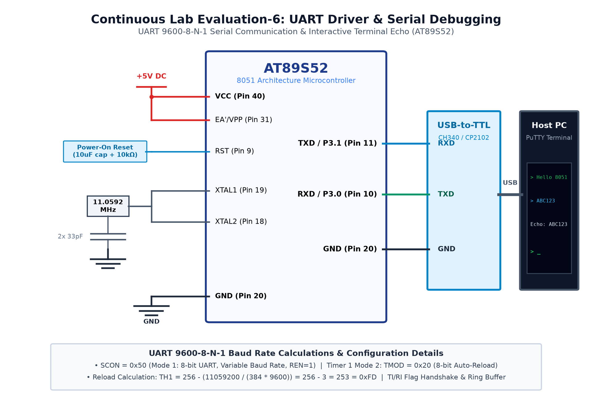

# EXPERIMENT DETAILS

**EXP:** CONTINUOUS ASSESMENT 6

**DATE:** 17/08/2026

**NAME OF EXP:** UART Driver Development & Serial Debugging Interface

**HARDWARE SETUP / PLATFORM:** AT89S52 Microcontroller + USB-to-UART Bridge + PC Terminal

---

## TASK 6B : Interrupt-Driven UART Echo with Circular Buffer

### 1. Circuit Diagram

The experiment demonstrates non-blocking, interrupt-driven serial reception and echoing using a circular ring buffer.

- **Development Board / Core:** 8051 Development Board
- **Microcontroller IC:** Atmel AT89S52 (40-Pin DIP)
- **GPIO Pin(s) / Peripherals:** P3.1 (TXD), P3.0 (RXD)
- **Power Supply / Interface:** CP2102 USB-to-TTL Adapter + PuTTY Terminal @ 9600 8-N-1

### 2. Core Logic / Pseudocode / Code Base

**Working Principle:**

When a character arrives, the UART hardware sets the RI flag and triggers an interrupt (vector 4). The ISR deposits the byte into a circular FIFO buffer. The main loop processes buffer contents and echoes characters back to the terminal.

**Pseudocode:**

1. Configure Timer 1 for 9600 baud and SCON for Mode 1.
2. Enable UART interrupt (ES = 1) and global interrupts (EA = 1).
3. In UART ISR: if RI is set, read SBUF, store in ring buffer, clear RI.
4. In main loop: if ring buffer has unread bytes, dequeue and transmit back.
5. Echo received characters with brackets (e.g. "[A]").

**Code Base:**

- `void uart_isr(void) interrupt 4`: Handles `RI` and `TI` interrupts.
- Circular buffer indices `head` and `tail` prevent data overwrite.
- Non-blocking architecture keeps main loop responsive.

### 3. Inference

Typing in the PuTTY terminal produced instantaneous echoed characters with zero data loss, demonstrating robust ring buffering.
