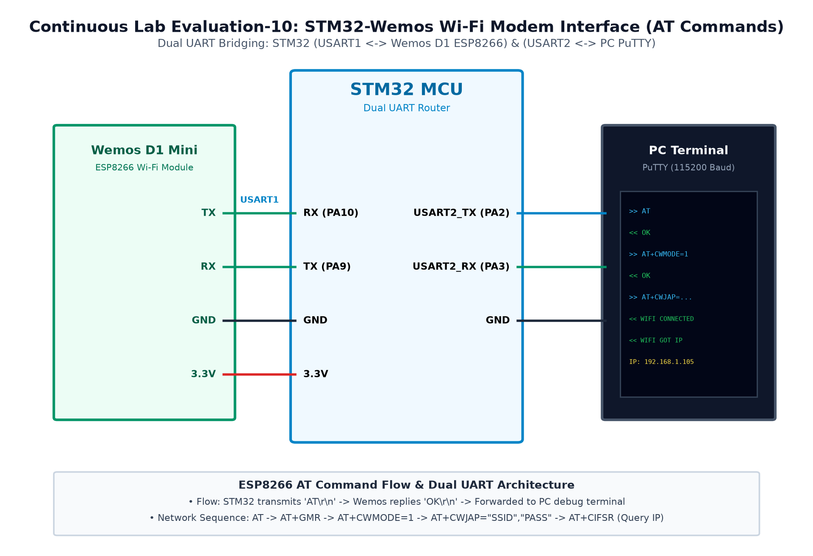

# EXPERIMENT DETAILS

**EXP:** CONTINUOUS ASSESMENT 11

**DATE:** 12/10/2026

**NAME OF EXP:** HTTP Server: STM32–Wemos Wi-Fi Modem Using AT Commands

**HARDWARE SETUP / PLATFORM:** STM32 NUCLEO-F401RE + Wemos D1 (ESP8266) + Node-RED

---

## TASK 11C : Node-RED as a Second HTTP Client of STM32/ESP8266 Server

### 1. Circuit Diagram

The experiment demonstrates configuring Node-RED as an automated HTTP client polling data from the STM32 web server.

- **Development Board / Core:** STM32 NUCLEO-F401RE
- **Microcontroller IC:** STM32F401RET6 (ARM Cortex-M4 @ 84 MHz)
- **GPIO Pin(s) / Peripherals:** PA9/PA10 (USART1), PA2/PA3 (USART2), PA5 (LED LD2)
- **Power Supply / Interface:** Node-RED Runtime ([Inject] -> [HTTP Request] -> [Debug])

### 2. Core Logic / Pseudocode / Code Base

**Working Principle:**

Node-RED uses an HTTP Request node to periodically issue GET requests to `http://<ESP8266_IP>/`. The STM32 detects the incoming connection, increments a request counter, packages system uptime and status, and transmits the response back to Node-RED.

**Pseudocode:**

1. Configure Node-RED flow: [Inject (every 5s)] -> [HTTP Request (GET)] -> [Debug].
2. Set HTTP Request node URL to http://<ESP8266_IP>/.
3. In STM32 firmware, track request_counter and uptime_sec.
4. When +IPD arrives, check requested URI:
   - /api or /data: deliver JSON payload.
   - /: deliver HTML dashboard.
5. Transmit response via 2-step AT+CIPSEND and close link.
6. Toggle on-board LED LD2 to confirm transaction.

**Code Base:**

- Node-RED flow: `[Inject] -> [HTTP Request] -> [Debug]`.
- Dynamic payload includes request counter and system uptime.
- LED LD2 toggles on each serviced HTTP request.

### 3. Inference

Node-RED received and displayed live HTTP responses from the STM32 web server in its Debug console on every trigger interval.
