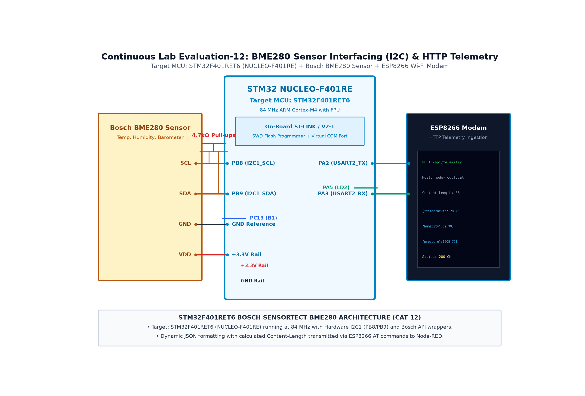

# EXPERIMENT DETAILS

**EXP:** CONTINUOUS ASSESMENT 13

**DATE:** 26/10/2026

**NAME OF EXP:** BME280 Data Acquisition & HTTP Cloud Ingestion

**HARDWARE SETUP / PLATFORM:** STM32 NUCLEO-F401RE + ESP8266 + Node-RED

---

## TASK 13C : Node-RED Cloud Ingestion Pipeline & Statistical Telemetry

### 1. Circuit Diagram

The experiment demonstrates receiving and visualizing STM32 HTTP telemetry inside a Node-RED dashboard pipeline.

- **Development Board / Core:** STM32 NUCLEO-F401RE
- **Microcontroller IC:** STM32F401RET6 (ARM Cortex-M4 @ 84 MHz)
- **GPIO Pin(s) / Peripherals:** PB8/PB9 (BME280), PA9/PA10 (ESP8266), PA2/PA3 (PC)
- **Power Supply / Interface:** Node-RED Ingestion Pipeline ([HTTP In] -> [JSON] -> [Chart])

### 2. Core Logic / Pseudocode / Code Base

**Working Principle:**

Node-RED exposes an HTTP endpoint (`/telemetry`) that receives incoming POST requests from the STM32. The JSON parser node decodes the payload, routes values to UI gauges, charts live trends, and logs historical statistics.

**Pseudocode:**

1. Deploy Node-RED flow with [HTTP In] listening on /telemetry.
2. Add [JSON Parser] node to convert incoming string to JavaScript object.
3. Connect [Gauge] and [Chart] nodes for temperature, humidity, and pressure.
4. Add [HTTP Response] node returning 200 OK to STM32.
5. Run STM32 firmware and observe real-time graphs updating in Node-RED UI dashboard.

**Code Base:**

- Node-RED flow: `[http in: /telemetry] -> [json] -> [ui_chart] -> [http response]`.
- Real-time time-series telemetry visualization.
- High-reliability ingestion confirmed by HTTP 200 return codes.

### 3. Inference

The Node-RED dashboard successfully received, parsed, and graphed live environmental data published by the STM32.
