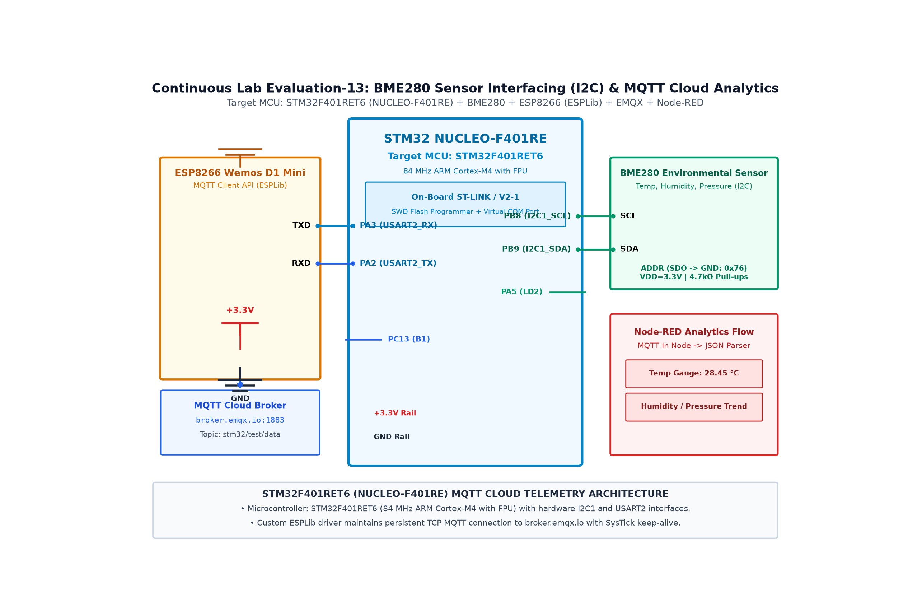

# EXPERIMENT DETAILS

**EXP:** CONTINUOUS ASSESMENT 14

**DATE:** 02/11/2026

**NAME OF EXP:** Environmental Sensing (BME280) & MQTT Cloud Analytics

**HARDWARE SETUP / PLATFORM:** STM32 NUCLEO-F401RE + ESP8266 + MQTT Broker

---

## TASK 14B : ESP8266 MQTT Client API & Cloud Telemetry

### 1. Circuit Diagram

The experiment demonstrates developing an MQTT client interface over AT commands to publish telemetry messages to a cloud broker.

- **Development Board / Core:** STM32 NUCLEO-F401RE
- **Microcontroller IC:** STM32F401RET6 (ARM Cortex-M4 @ 84 MHz)
- **GPIO Pin(s) / Peripherals:** PA9/PA10 (USART1 to ESP8266), PA2/PA3 (USART2 to PC Debug)
- **Power Supply / Interface:** Wemos D1 + broker.emqx.io (Port 1883)

### 2. Core Logic / Pseudocode / Code Base

**Working Principle:**

The firmware implements an AT-command-based MQTT state machine: it initializes the modem, sets user client parameters (`AT+MQTTUSERCFG`), establishes connection (`AT+MQTTCONN`), and publishes JSON packets (`AT+MQTTPUB`) with QoS 0.

**Pseudocode:**

1. Connect to Wi-Fi access point "SNUC".
2. Issue AT+MQTTUSERCFG to set client ID "STM32_Node".
3. Issue AT+MQTTCONN to connect to broker.emqx.io on port 1883.
4. Format telemetry payload: {"uptime": ..., "status": "ONLINE"}.
5. Issue AT+MQTTPUB=0,"stm32/test/data","<payload>",0,0.
6. Confirm "OK" response from modem.
7. Repeat periodically and handle reconnection if broker drops.

**Code Base:**

- `AT+MQTTUSERCFG`: Configures MQTT client credentials and clean session flag.
- `AT+MQTTCONN`: Connects to public broker `broker.emqx.io`.
- `AT+MQTTPUB`: Publishes payload to topic `stm32/test/data`.
- Reconnection state machine handles network dropouts.

### 3. Inference

MQTT messages were successfully published to the cloud broker and verified using a live MQTT subscriber.
