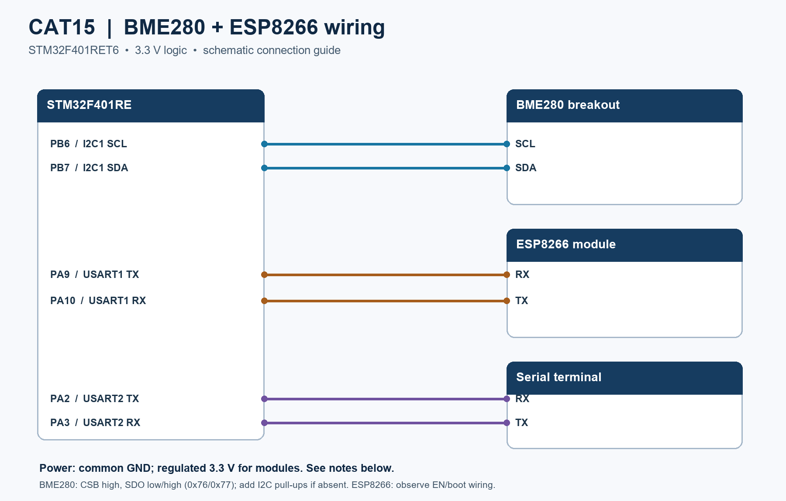

# EXPERIMENT DETAILS

**EXP:** CONTINUOUS ASSESMENT 15

**DATE:** Not specified

**NAME OF EXP:** BME280 Environmental Monitoring & MQTT Telemetry

**HARDWARE SETUP / PLATFORM:** STM32F401RE + BME280 + ESP8266 + STM32CubeMX + Keil MDK

---

## Overview

This experiment reads temperature, pressure and humidity from a BME280 over I2C and publishes JSON telemetry through an ESP8266 to an MQTT broker. The project also sends status and sensor readings to a serial terminal.

## Dedicated Task

- **[TASK 15: BME280 Environmental Monitoring & MQTT Telemetry](TASK15/)**: Sensor acquisition and MQTT publishing using the supplied STM32 project.

### Circuit Diagram

### Inference

The firmware combines I2C sensing, serial communication and MQTT publishing in an environmental monitoring node. Hardware operation and message delivery should be verified on the assembled circuit.
