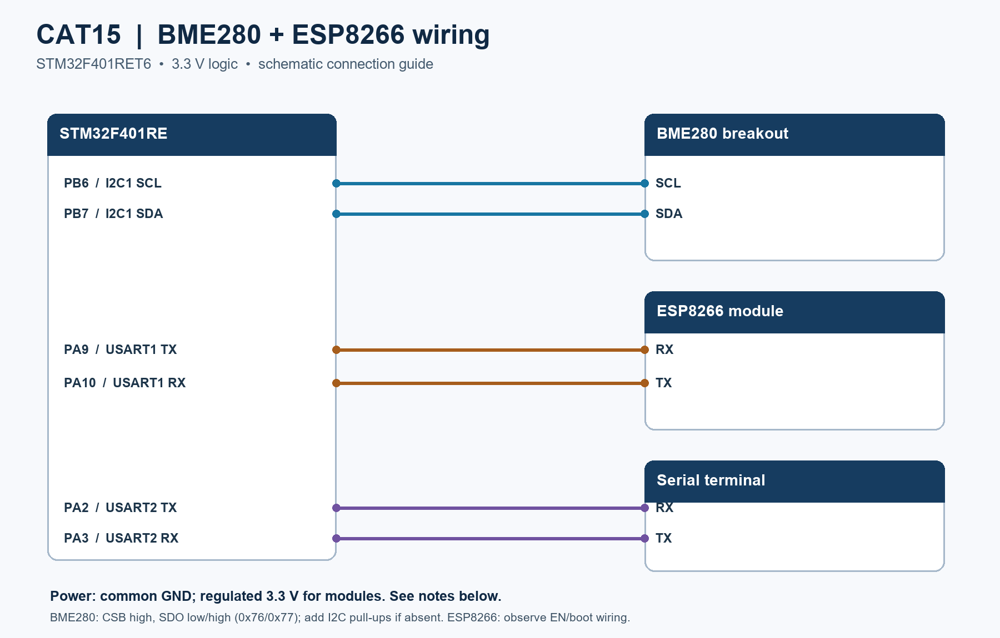

# EXPERIMENT DETAILS

**EXP:** CONTINUOUS ASSESMENT 15

**DATE:** Not specified

**NAME OF EXP:** BME280 Environmental Monitoring & MQTT Telemetry

**HARDWARE SETUP / PLATFORM:** STM32F401RE + BME280 + ESP8266 + MQTT broker

---

## TASK 15 : BME280 Environmental Monitoring & MQTT Telemetry

### 1. Circuit Diagram

The diagram shows the connections indicated by the CubeMX configuration. It assumes a 3.3 V BME280 breakout and a 3.3 V ESP8266 module; check the actual module pinout and regulator before wiring.

- **Microcontroller:** STM32F401RET6 (ARM Cortex-M4, configured at 84 MHz)
- **I2C1:** PB6 / SCL and PB7 / SDA to the BME280; use pull-ups to 3.3 V as needed by the breakout.
- **USART1:** PA9 / TX to ESP8266 RX; PA10 / RX from ESP8266 TX, 115200 baud.
- **USART2:** PA2 / TX and PA3 / RX to a 3.3 V-compatible serial terminal, 115200 baud.
- **Power:** Common ground; provide a stable 3.3 V supply suitable for ESP8266 current peaks. Set BME280 CSB high for I2C and SDO low or high for address 0x76 or 0x77, respectively, if the breakout exposes these pins. Follow the ESP8266 board's enable and boot requirements.

### 2. Core Logic / Pseudocode / Code Base

**Working Principle:**

The STM32 initializes I2C1 and two UARTs, detects the sensor at address 0x76 or 0x77, initializes the Bosch driver, and connects the ESP8266 to Wi-Fi and the MQTT broker. It reads and prints environmental data and calls the MQTT publish function every five seconds.

**Pseudocode:**

1. Initialize clocks, GPIO, I2C1, USART1 and USART2.
2. Detect and configure the BME280 in normal mode.
3. Initialize the ESP8266 and connect to Wi-Fi.
4. Open a TCP connection to `broker.emqx.io` on port `1883` and send an MQTT CONNECT packet.
5. Read the sensor, format a JSON message and publish to `college/weather/bme280` at QoS 0.
6. Repeat after a 5 second delay; observe serial output and subscribe with an MQTT client.

**Code Base:**

- `Core/Src/main.c`: application logic and peripheral setup.
- `Core/Src/bme280.c` and `Core/Inc/bme280*.h`: Bosch BME280 driver.
- `Core/Src/ESPLib.c` and `Core/Inc/ESPLib.h`: ESP8266 and MQTT functions.
- `IOT_project.ioc`: STM32CubeMX configuration; `MDK-ARM/IOT_project.uvprojx`: Keil project.
- Payload example: `{"temperature":25.00,"pressure":1013.25,"humidity":50.00}` (pressure in hPa).

**Build and run:**

1. Open `MDK-ARM/IOT_project.uvprojx` in Keil MDK with the STM32F4 device support installed.
2. Set the Wi-Fi SSID and password locally in the `ESP8266_wifiConnect` call in `Core/Src/main.c`; do not commit credentials. The repository contains placeholders.
3. Build and flash the firmware, connect a serial terminal at 115200 8-N-1, and subscribe to the topic using an MQTT client.

The broker connection uses unencrypted TCP, and the supplied code prints status messages without verifying each publish. On a failed sensor read the loop can still attempt to publish the previous values; check the terminal and subscriber when testing.

### 3. Inference

The supplied firmware demonstrates the intended path from BME280 measurements to MQTT telemetry. Successful sensor readings and broker delivery depend on the physical setup and network and have not been verified here.
